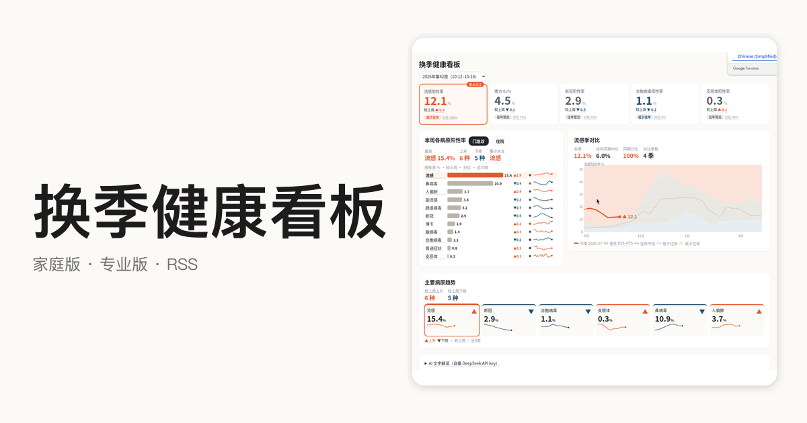

# Tolson

做能长期自己更新的小产品。医疗×数据看板，以及 Huberman 播客中文精读。

## 换季健康看板

中国呼吸道等多病原周看板：家庭版一眼看懂，专业版细看，可 Obsidian RSS 订阅。数据来自 CNIC / 疾控哨点 / 法定传染病月报 / Open-Meteo。

[看板](https://tolsonhuddy-collab.github.io/cn-resp-weekly/) · [专业版](https://tolsonhuddy-collab.github.io/cn-resp-weekly/pro.html) · [RSS](https://tolsonhuddy-collab.github.io/cn-resp-weekly/feed.xml) · [仓库](https://github.com/tolsonhuddy-collab/cn-resp-weekly)

## Huberman Lab 中文精读

Huberman Lab 播客中文精读，已有 105 篇，持续更新。

[阅读](https://huberman-reading-001.tolsonhuddy.chatgpt.site/) · [仓库](https://github.com/tolsonhuddy-collab/huberman-tolson-cn)

---

也在留意：[史记知识库 shiji-kb](https://github.com/tolsonhuddy-collab/shiji-kb)（fork）
